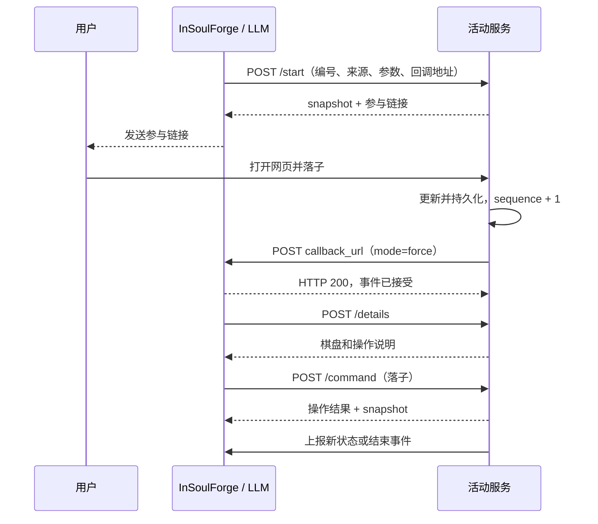

# 实时活动应用开发指南

本文面向独立活动服务开发者，说明必须实现的功能、HTTP 接口、生命周期、通知规则与接入方法。可以使用任何支持 HTTP 的语言，不需要依赖 InSoulForge 的代码或 SDK。

以下约定对应当前实现。“必须”表示接入要求，“建议”表示推荐做法。所有名称、身份与密钥示例均为虚构测试数据。

## 1. 最小实现清单

| 能力 | 必须实现的行为 |
| --- | --- |
| 常驻服务 | 服务预先运行，活动结束后 HTTP 服务仍然可用 |
| 全局单例 | 同一种活动同时只有一个实例，不按来源群聊分别创建 |
| 五个接口 | `POST /status`、`/start`、`/command`、`/stop`、`/details` |
| 密钥认证 | 验证主程序的 Bearer 密钥，回调使用同一个密钥 |
| 状态快照 | 提供运行标志、启动编号、递增序号、简短状态及启动来源 |
| 主动上报 | 状态变化、需要模型参与或活动结束时，向主程序投递事件 |
| 持久化 | 保存运行编号、序号、来源、回调地址及业务进度，重启后可恢复 |
| 业务约束 | 服务自行校验操作、权限、并发和合法状态，例如棋局回合与胜负 |
| 操作说明 | 通过 `/details` 告诉模型支持哪些操作、参数如何填写 |

网页、玩家登录、WebSocket、棋盘等属于服务自己的业务接口，按需实现。没有网页的持续观察服务也可以接入。

建议先运行[井字棋示例](../examples/tic_tac_toe.py)，确认完整流程，再替换业务逻辑。

## 2. 角色与整体流程

- **InSoulForge**：管理服务配置、活动单例、模型工具、共享上下文和回复调度。
- **LLM**：决定是否启动、指挥或停止，通过工具调用服务。
- **活动服务**：负责业务逻辑、状态、用户参与入口和主动事件。
- **用户**：通过服务返回的网页等方式参与，不要求在聊天中输入业务操作。

不同名称的活动可以同时运行，同名活动只有一个。所有群聊和私聊共享活动信息及模型工具；来源群聊不构成主程序层面的控制权限限制，具体业务规则由服务决定。

以井字棋为例：



活动与日常聊天同时进行。模型不会一直等待活动，也不会获得永久运行的独立对话循环；需要模型再次参与时，由服务发送事件。

## 3. HTTP 与认证

### 3.1 地址与方法

五个接口全部为 POST，路径相对于后台配置的服务地址：

| 配置的服务地址 | 状态查询实际地址 |
| --- | --- |
| `http://127.0.0.1:8090` | `http://127.0.0.1:8090/status` |
| `https://example.com/chess` | `https://example.com/chess/status` |

当前 `/status` 请求只有 `{}`，不会附带名称。因此一个配置地址必须独立确定对应活动。一个进程提供多种活动时，使用不同地址前缀，如 `/chess/status`、`/watcher/status`。

请求及响应使用 UTF-8 JSON 对象：

```http
Content-Type: application/json
Authorization: Bearer <共享密钥>
```

服务地址和回调地址使用 HTTP(S)，不使用带凭据、查询参数或片段的配置 URL。参与网页链接可以带查询参数。

### 3.2 密钥

服务与后台填写相同密钥，至少 16 字节，不含换行；建议使用足够长的随机 ASCII 字符串。

- 服务必须验证五个接口的 `Authorization`。
- 服务回调时使用相同的 Bearer 密钥。
- 不使用管理员 Cookie 或主程序每次启动生成的管理后台登录令牌。
- 不把密钥放进状态、业务响应、参与链接、操作说明或通知正文，这些内容可能进入模型上下文及调试记录。
- 网页用户的访问控制由服务自己设计，不要求玩家输入服务共享密钥。

### 3.3 当前限制

| 项目 | 约束 |
| --- | --- |
| 主程序向服务的单次 HTTP 请求 | 超时 10 秒，工具操作后还可能追加状态查询 |
| 服务响应 | 最大 1 MiB，必须是 JSON 对象 |
| `status` | 最多 4096 UTF-8 字节，建议只写一两句 |
| 回调 `text` | 最多 65536 UTF-8 字节 |
| 整个回调请求体 | 最多 128 KiB |
| `sequence` | 非负的有符号 64 位范围整数，不能使用小数或字符串 |
| 配置名称 | 非空、全局唯一、最多 80 UTF-8 字节，不含控制字符 |

主程序只把 HTTP 2xx 当作业务响应解析。建议统一返回 200；204 没有 JSON 正文，会被视为错误。非 2xx 的响应正文目前不会完整转交模型，模型主要看到 HTTP 错误码。

## 4. 状态与身份

### 4.1 完整快照

```json
{
  "running": true,
  "run_id": "demo-run-001",
  "sequence": 3,
  "status": "井字棋进行中，轮到机器人执 O 落子",
  "origin": {
    "session_id": "group:example-room",
    "user_id": "example-user"
  }
}
```

| 字段 | 类型 | 含义 |
| --- | --- | --- |
| `running` | boolean | 活动是否仍然存在；暂停、停止处理中仍为 true，确认结束才为 false |
| `run_id` | string | 主程序每次启动时生成的唯一编号，服务原样保存和返回，不自行替换 |
| `sequence` | integer | 本次运行的版本，从 0 开始递增，重启后继续递增 |
| `status` | string | 给模型看的简短状态，表达进展、阻塞原因或下一步 |
| `origin` | object | 最初启动的会话与用户，整个运行期间不改变 |

**`/status` 应始终返回带 `origin` 的完整快照。** 主程序缺少本地恢复文件时需要依靠它恢复来源。操作响应的快照在主程序已知来源时可省略 origin，但统一使用完整格式最简单。

棋盘、可用动作、业务日志等详细数据放在 `/details` 或操作结果中，不必塞进简短状态。

### 4.2 序号规则

1. 同一 run_id 内，状态或通知产生新内容时增加序号；允许有间隔，不要求连续。
2. 同一序号代表同一份不可变快照，不得保持序号不变却修改 running 或 status。
3. 查询状态、查询详情、刷新网页、重试同一回调，不应增加序号。
4. 重试回调复用原序号和原正文，不把一次事件变成多次新通知。
5. 新一轮使用新的 run_id，序号可从 0 重新开始。
6. 已结束的一轮不再改变状态，重开必须收到新的启动请求。

| 变化 | run_id | sequence | running | status |
| --- | --- | --- | --- | --- |
| 启动 | demo-run-001 | 0 | true | 等待玩家进入 |
| 玩家落子 | demo-run-001 | 1 | true | 轮到机器人落子 |
| 主程序查询 | demo-run-001 | 1 | true | 轮到机器人落子 |
| 机器人落子 | demo-run-001 | 2 | true | 轮到玩家落子 |
| 暂停 | demo-run-001 | 3 | true | 棋局已暂停 |
| 结束 | demo-run-001 | 4 | false | 玩家获胜，本局结束 |
| 新局 | demo-run-002 | 0 | true | 等待玩家进入 |

### 4.3 用户和会话

`user_id` 是字符串，不保证为纯数字；`system` 表示内部事件触发的调用，不是真实用户。

`session_id` 是规范会话字符串：群聊如 `group:example-room`，私聊如 `private:example-user`。
目标 ID 除 ASCII 字母、数字及 `-._~` 外的 UTF-8 字节使用 `%HH` 编码，十六进制必须大写。例如用户 ID `user:alice` 对应 `private:user%3Aalice`。普通数字群号可表示为 `group:123456`。

通常原样保存并使用来源即可，不需要拆解会话 ID。不要把整个 session_id 当成 OneBot 的 group_id，也不要将用户身份转为数字。

## 5. 公共请求与工具参数

除 `/status` 外，四个工具接口共用以下外层请求格式：

```json
{
  "name": "井字棋",
  "run_id": "demo-run-001",
  "origin": {"session_id": "group:example-room", "user_id": "example-user"},
  "caller": {"session_id": "private:another-user", "user_id": "another-user"},
  "arguments": {"parameters": {}},
  "callback_url": "http://127.0.0.1:7778/activities/events"
}
```

| 字段 | 类型 | 来源与用途 |
| --- | --- | --- |
| `name` | string | 后台配置的活动名称，回调时必须完全一致 |
| `run_id` | string | 当前活动轮次的启动编号 |
| `origin` | object | 最初启动来源，其他群聊操作时也不改变；包含字符串 session_id、user_id |
| `caller` | object | 本次调用来源，结构与 origin 相同；活动通知触发时 user_id=system |
| `arguments` | object | 模型的业务指令和参数，见下表 |
| `callback_url` | string | 完整事件接收地址，服务直接使用，不自行拼接路径 |

来源由主程序填入，不由模型在业务参数中自报。后续 caller 不得覆盖最初 origin，具体业务限制由服务决定。

| 模型工具 | 模型填写的业务参数 | 服务收到的 arguments |
| --- | --- | --- |
| `start_activity` | 可选 parameters | `{"parameters": {...}}`，省略参数时为 `{"parameters": {}}` |
| `command_activity` | 必填 instruction，可选 parameters | `{"parameters": {...}, "instruction": "..."}` |
| `stop_activity` | 无 | `{"parameters": {}}` |
| `get_activity_details` | 无 | `{"parameters": {}}` |

不要把模型的 parameters 当成整个 HTTP 请求体，也不要假设 instruction 位于最外层。

除 status 接口外，响应中的 snapshot 为可选字段，建议提供；存在时主程序会校验并应用它。没有 snapshot 时仍会追加状态查询，但不会把根级 running 当成快照。success、accepted 等业务字段会交给模型，不直接控制运行列表。

## 6. 五个必需接口

### 6.1 POST /status：查询与恢复

请求固定为：

```json
{}
```

**响应直接是快照，不加 snapshot 或 data 包装。** 从未接受过任何启动请求时，可以返回：

```json
{"running": false}
```

已有活动时返回第 4 节的完整快照。结束后继续保存最后一轮的信息：

```json
{
  "running": false,
  "run_id": "demo-run-001",
  "sequence": 8,
  "status": "本局结束，玩家获胜",
  "origin": {"session_id": "group:example-room", "user_id": "example-user"}
}
```

已有运行记录时，不要在服务重启后简单返回 `{"running":false}`。主程序可能仍持有原运行状态，需要明确确认该轮是否结束。

主程序启动后查询所有已启用服务，正常约每 30 秒查询一次。失败后按约 5、10、20、40……最多 300 秒退避；调度器每 5 秒检查一次，实际间隔还包含请求和调度耗时。每次工具操作后也会核实状态。

此接口必须快速、只读，不启动活动、不递增序号、不产生通知。

### 6.2 POST /start：启动

请求示例：

```json
{
  "name": "井字棋",
  "run_id": "demo-run-001",
  "origin": {"session_id": "group:example-room", "user_id": "example-user"},
  "caller": {"session_id": "group:example-room", "user_id": "example-user"},
  "arguments": {"parameters": {"difficulty": "normal"}},
  "callback_url": "http://127.0.0.1:7778/activities/events"
}
```

处理顺序：

1. 验证认证、字段与业务参数。
2. 原子检查是否已有活动，不能并发创建两局。
3. 相同 run_id 的重复启动返回原有活动，不重置业务进度。
4. 接受新运行后，保存名称、编号、来源、回调地址、初始序号及业务数据。
5. 返回快照及参与信息；耗时准备工作可异步继续，通过状态和回调交付进展。

推荐响应：

```json
{
  "success": true,
  "url": "http://127.0.0.1:8090/play?run_id=demo-run-001",
  "message": "玩家执 X 先手，请打开链接参与棋局。",
  "snapshot": {
    "running": true,
    "run_id": "demo-run-001",
    "sequence": 0,
    "status": "等待玩家进入棋局",
    "origin": {"session_id": "group:example-room", "user_id": "example-user"}
  }
}
```

url、message 是推荐业务字段，不是固定协议要求。除特殊处理 snapshot 外，主程序把响应对象作为工具结果交给模型，由模型决定如何回复。

已有不同 run_id 的活动时拒绝创建第二个实例，保留原状态。至少保留最后一次结束的编号，防止重复启动复活已结束的一局；需要处理跨多轮的延迟重放时，额外保存历史启动记录。

业务明确拒绝启动时，可返回 HTTP 200 的失败对象与本次运行的结束快照，但必须也保存这个快照，让随后 `/status` 返回一致结果。不要在响应中宣称本次运行已结束，却让状态接口返回冲突数据。

请求超时不代表启动失败。主程序会查询实际状态，不会自动重发 start；状态查询必须能够判断请求是否生效。

### 6.3 POST /command：指挥

使用第 5 节外层请求，arguments 例如：

```json
{
  "parameters": {"cell": 5},
  "instruction": "落子"
}
```

instruction 是非空文本，parameters 是可选 JSON 对象。主程序不解析“落子”“暂停”等指令，也不替服务校验回合和权限。

先检查 run_id，再校验操作，并在同一个临界区更新业务和快照，不能让其他请求看到半更新的数据。

成功响应示例：

```json
{
  "success": true,
  "message": "机器人已在 5 号格落子",
  "board": ["X", "", "", "", "O", "", "", "", ""],
  "snapshot": {
    "running": true,
    "run_id": "demo-run-001",
    "sequence": 2,
    "status": "轮到玩家执 X 落子",
    "origin": {"session_id": "group:example-room", "user_id": "example-user"}
  }
}
```

可修正的业务错误建议使用 HTTP 200，让模型看到具体说明：

```json
{
  "success": false,
  "error": "5 号格已有棋子，请选择其他空格。"
}
```

也可附带当前一致的 snapshot。若返回 HTTP 400，当前主程序主要报告 HTTP 错误码，不会完整转交业务正文。

协议没有每次操作独立的 command_id。run_id 只能区分活动轮次，不能作为所有操作的去重键。重复执行有风险时，可在自己的 parameters 中增加版本、操作编号或目标状态，并在详情中说明。普通落子也必须检查目标格和回合。

### 6.4 POST /stop：结束

使用第 5 节公共请求，arguments 为 `{"parameters":{}}`。

能立即停止时，完成收尾、持久化后返回：

```json
{
  "success": true,
  "snapshot": {
    "running": false,
    "run_id": "demo-run-001",
    "sequence": 9,
    "status": "棋局已停止",
    "origin": {"session_id": "group:example-room", "user_id": "example-user"}
  }
}
```

停止需要等待时，可以先返回 `{"accepted":true}`。期间 running 仍为 true，status 可写“正在结束棋局”。真正停止后再上报 running:false，并让状态接口返回相同结束快照。

**accepted:true、HTTP 200 或工具调用结束，都不等于活动已结束。** 主程序不会强杀服务进程，也不会因为发送停止请求就立即移除活动。

建议重复停止同一次已结束运行时返回原结束快照，不产生副作用。不要把 stop 实现为退出 HTTP 服务，否则主程序无法确认结束状态。

### 6.5 POST /details：详情和操作说明

使用第 5 节公共请求，arguments 为 `{"parameters":{}}`。只读，不增加序号或通知。

推荐响应：

```json
{
  "snapshot": {
    "running": true,
    "run_id": "demo-run-001",
    "sequence": 1,
    "status": "轮到机器人执 O 落子",
    "origin": {"session_id": "group:example-room", "user_id": "example-user"}
  },
  "board": ["X", "", "", "", "", "", "", "", ""],
  "turn": "O",
  "legal_cells": [2, 3, 4, 5, 6, 7, 8, 9],
  "rules": "玩家执 X 先手，机器人执 O；格子从左到右、从上到下编号 1～9，只能下空格。",
  "commands": [
    {"instruction": "落子", "parameters": {"cell": 5}, "description": "仅在 O 回合有效"},
    {"instruction": "暂停", "description": "暂停棋局"},
    {"instruction": "恢复", "description": "恢复棋局"}
  ]
}
```

详情结构由服务定义。应让模型清楚当前能做什么、instruction 与 parameters 如何填写、业务限制和操作后果是什么。

当前详情工具主要用于主程序本地已知的运行中活动，不是初次恢复入口。启动恢复始终通过 `/status` 完成。

## 7. 主动事件回调

### 7.1 请求格式

向启动请求提供的完整 callback_url 发起 POST，带同一个 Bearer 密钥：

```json
{
  "name": "井字棋",
  "run_id": "demo-run-001",
  "sequence": 1,
  "running": true,
  "status": "轮到机器人执 O 落子",
  "text": "玩家已在 1 号格落子，请查询棋局并选择机器人下一步。",
  "mode": "force",
  "target_session": "group:example-room"
}
```

| 字段 | 是否必需 | 说明 |
| --- | --- | --- |
| name | 必需 | 与配置及启动请求中的名称完全一致 |
| run_id | 必需 | 当前运行编号，不能使用上一局的编号 |
| sequence | 必需 | 事件对应快照的版本，遵循第 4 节规则 |
| running | 必需 | 活动结束时为 false |
| status | 必需 | 最新简短状态，不能只传通知正文 |
| text | 可省略 | 会话通知正文；省略或为空时只更新活动状态 |
| mode | 可省略 | silent、judge、force，默认 silent |
| target_session | 可省略 | 通知目标，默认最初启动会话，也可指定其他群聊或私聊 |

主程序从运行记录补充最初 origin，回调不能覆盖来源。服务可以附带 origin，但它不会改变通知目标；改变目标使用 target_session。

### 7.2 三种通知模式

| mode | 主程序行为 | 适用场景 |
| --- | --- | --- |
| silent | 更新状态；有正文时只记录，不启动回复流程 | 普通进度、机器人自身刚执行完的操作 |
| judge | 记录正文后由现有路由判断是否回复 | 有信息值得告知，但不一定需要打断聊天 |
| force | 记录正文后跳过“是否回复”的判断，进入 Executor | 轮到机器人操作、重要结果或结束通知 |

必须了解：

- **没有非空 text 时，即使 mode=force，也不会触发模型。**
- silent 表示不触发回复流程，不表示记录永远不参与上下文或记忆处理。
- force 表示触发模型处理，不保证模型一定发送消息、一定调用某个工具或一定操作成功。
- 机器人总开关和目标会话启用状态仍然有效；群聊 judge 还遵循自动回复开关。
- 同会话回复串行处理，多条等待通知可能合并成一次模型处理，正文仍保留在消息列表。
- 通知由模型组织回复，不会被回调接口直接原样发到聊天平台。

不要把每帧画面、每次网页轮询或心跳都作为 force 通知。普通进度只更新状态，需要模型参与时再提供明确正文。

### 7.3 结束事件

自然完成、用户在网页结束、服务决定终止，都通过 running:false 报告：

```json
{
  "name": "井字棋",
  "run_id": "demo-run-001",
  "sequence": 8,
  "running": false,
  "status": "本局结束，玩家获胜",
  "text": "井字棋已结束，玩家执 X 获胜。",
  "mode": "force"
}
```

先保存结束状态再发送。此后 `/status` 继续返回同一运行的结束快照。主程序确认后移除运行列表中的活动，同时仍可处理结束通知。

### 7.4 响应与重试

主程序成功接受或按去重规则忽略事件时返回 HTTP 200：

```json
{"success": true}
```

失败示例：

```json
{"success": false, "error": "活动启动标识不匹配"}
```

| HTTP 状态 | 含义及处理 |
| --- | --- |
| 200 | 已接受或忽略，不代表模型完成了操作或回复 |
| 400 | 字段、序号、运行编号或目标不合法；按原因修正，不盲目制造新事件 |
| 401 | 密钥无效、服务未启用、名称不匹配，或接收端已停止接收；检查配置 |
| 413 | 整个事件超过 128 KiB，需要精简 |
| 超时、无响应、5xx | 结果不确定，建议有界退避重试同一事件，复用原序号和正文 |

主程序尚未恢复该运行时，可能返回 400 并说明“尚未恢复该活动”。等待状态同步后可重试同一事件，不要更换 run_id。

建议持久化待发送事件并使用独立发送队列，避免持有业务锁等待网络。最小示例只演示回调，不提供完整可靠投递队列。

已确认的事件需要再次提醒模型时，应产生一条有新内容的提醒事件并递增序号，而不是重发已经确认的版本；重发旧版本只会被去重。

### 7.5 去重和时序边界

主程序分别记录状态版本和已处理回调的版本：

| 情况 | 当前行为 |
| --- | --- |
| 工具响应先同步版本 N，随后版本 N 的回调到达 | 仍允许通知一次 |
| 同一运行、同一版本回调重复到达 | 确认成功，不重复通知 |
| 版本 N 回调到达，但已知道更高版本 N+1 | 作为旧事件忽略，不补发其通知正文 |
| 上一轮编号的事件迟到 | 拒绝，不能修改或结束新一轮活动 |
| 已结束运行收到更高序号，试图重新激活 | 拒绝，新活动需要新的启动请求 |

尽量按顺序发送通知，让最新状态包含当前仍需处理的信息。需要机器人行动的正文应能独立说明当前任务，不依赖每条历史进度必达。

当前协议不是严格可靠的跨进程消息队列：主程序保存去重信息后、投递会话前崩溃，通知可能没有触发回复。机器人关闭、会话未启用或模型决定不回复时，HTTP 200 也不保证用户收到消息。必须以服务自己的业务状态判断机器人是否已经行动，不能仅凭回调成功认定机器人已落子。

## 8. 持久化、并发与重启

服务至少保存以下内容：

| 数据 | 用途 |
| --- | --- |
| name、run_id | 识别活动及当前轮次 |
| origin、callback_url | 恢复来源和事件接收地址 |
| running、sequence、status | 重启后返回一致快照 |
| 业务数据 | 棋盘、回合、暂停标志、参与者、观察位置等 |
| 待发事件，建议保存 | 网络恢复后继续通知 |

可以使用 JSON 文件或数据库。文件建议写入临时文件后原子替换，避免留下半份数据。密钥由环境变量或服务配置管理，不必放在业务快照里。

每次业务变化建议按此顺序处理：

```text
取得业务锁或开启事务
  检查 run_id、业务状态和参数
  更新业务数据、running 和 status
  sequence 增加一次
  保存新状态，取得同版本快照和通知内容
释放业务锁或提交事务
把必要通知放入独立发送队列
返回 HTTP 结果
```

HTTP 响应与回调的到达顺序不固定。两者代表同一次变化时，应使用同一份快照和序号。

| 重启或失联场景 | 要求 |
| --- | --- |
| 主程序重启，服务仍运行 | 查询状态恢复原运行，不创建新活动 |
| 服务重启，业务能恢复 | 使用原 run_id 和业务数据，序号不归零 |
| 服务重启，业务不能继续 | 保存原 run_id 的更高序号结束快照，说明原因，条件允许时通知 |
| 两端都重启 | 服务先从持久化数据恢复，主程序随后查询 |
| 主程序暂时失联 | 活动按自身规则继续或暂停，保留状态并重试必要通知 |
| 活动服务暂时失联 | 主程序保留最后状态并标记未确认，不假定活动结束 |

**启动恢复查询只同步状态，不自动为“轮到机器人”生成模型调用。** 恢复后仍需有效通知，或由用户在聊天中让机器人查询并继续。

## 9. 模型上下文与操作设计

Executor 获得已启用活动的名称和用途目录。每次构建回复上下文，主程序读取管理器中的状态快照：

```json
{
  "running_activities": [
    {"name": "井字棋", "status": "轮到机器人执 O 落子"}
  ]
}
```

该字段放在上下文 JSON 最后，位于 recent_messages 及可选的 response_requirements 之后，所有会话共享。只列仍运行的活动，暂停保留，结束移除。构建聊天上下文时不等待外部状态请求。

服务失联或状态超过 90 秒未确认时，主程序在文字中追加“状态未确认”和最近更新时间。正常状态查询也会刷新确认时间，不要求服务每隔几秒主动发送心跳。

建议这样设计模型可见内容：

- 后台描述说明活动用途和适合启动的场景。
- status 说明当前进展及下一步，例如“轮到机器人执 O 落子”，不要只写“正常”。
- details 提供完整业务数据、指令、参数类型、编号规则和限制。
- 业务失败给出可执行的修正建议，例如有效格子或合法状态。
- 需要模型参与时，用合适的通知模式，并在正文中明确当前需要做什么。

## 10. 本地接入与部署

### 本地全部直接运行

假设主程序端口为 7778，活动服务端口为 8090：

| 配置项 | 内容 |
| --- | --- |
| 活动名称 | 井字棋 |
| 服务地址 | `http://127.0.0.1:8090` |
| 主程序事件回调地址 | `http://127.0.0.1:7778/activities/events` |
| 两端共享密钥 | 完全相同的 ASCII 字符串 |
| 参与链接 | 玩家浏览器能访问的 `http://127.0.0.1:8090/play?...` |

先启动服务，配置并启用，等待主程序成功查询一次状态，再通过工具启动活动。运行服务进程不等于启动了活动。

以下密钥仅用于本机联调示例：

```bash
export ACTIVITY_TOKEN='local-activity-demo-key-123456'
```

从主程序所在网络环境检查状态：

```bash
curl --noproxy '*' -sS http://127.0.0.1:8090/status \
  -H 'Content-Type: application/json' \
  -H "Authorization: Bearer $ACTIVITY_TOKEN" \
  --data '{}'
```

首次预期返回 `{"running":false}`。直接在浏览器打开 `/status` 会发送 GET 且没有 Bearer 认证，不能据此判断协议接口是否正常。

### 容器或跨机器

区分三个地址：

1. **服务地址**：主程序能够访问的活动 HTTP 地址。
2. **回调地址**：活动服务能够访问的主程序事件地址。
3. **参与链接**：用户浏览器能够访问的网页地址。

三者主机名可以不同。容器中的 127.0.0.1 指该容器自身；同一 Docker 网络可使用实际服务名。0.0.0.0 用于监听，不应填写为访问地址。跨机器部署还要开放对应端口，并按环境配置 HTTPS。

保存启动请求中的完整 callback_url，不硬编码主程序 IP。Python 等库可能读取系统代理，本机或内网通信需确认请求能直达目标；井字棋示例的回调使用直连。

## 11. 联调验收清单

手工启动测试建议使用独立服务实例和状态文件，避免与真实活动争用运行记录。

| 检查项 | 预期结果 |
| --- | --- |
| 无密钥、错误密钥访问五个接口 | 拒绝，状态不变 |
| 首次 status | HTTP 200，JSON 对象，running:false |
| start | 返回对应 run_id 的快照和参与信息 |
| 相同 run_id 重复启动 | 返回原活动，不清空进度 |
| 运行中换 run_id 启动 | 不创建第二个实例，原活动不变 |
| 多次查询状态、详情 | 业务数据和序号不变 |
| 合法 command | 更新一次业务状态，返回正确快照 |
| 非法操作、错误 run_id | 明确拒绝，业务数据与序号不变 |
| 暂停和恢复 | 暂停仍 running，恢复保持原 run_id |
| 无 text 的状态上报 | 状态更新，不生成回复 |
| silent 带 text | 记录正文，不触发回复流程 |
| judge 带 text | 主程序判断是否回复，可能跳过 |
| force 带 text | 进入模型处理流程 |
| 重复、乱序回调 | 不重复通知，不覆盖更新状态 |
| 工具快照先到，同版本回调后到 | 通知仍有一次处理机会 |
| 相同序号改变状态 | 主程序拒绝，服务应增加序号 |
| 自然结束与 stop | 最终 running:false，从运行列表移除 |
| 重复停止 | 不产生额外副作用、不复活活动 |
| 活动服务重启 | 编号、来源、序号及业务进度保留 |
| 主程序重启 | 通过 status 恢复，不重开活动 |
| 旧一轮的结束事件迟到 | 不关闭新一轮 |
| 超时、断网、回调失败 | 保留真实状态，不自动重复执行有副作用的操作 |

在“请求调试”页查看标签为 Activity 的出站请求。公开问题报告前，移除真实身份、参与凭据和密钥等私有数据。

## 12. 常见问题

| 现象 | 优先检查 |
| --- | --- |
| 活动服务状态尚未确认 | 从主程序所在环境以 POST 和正确密钥访问 status；检查服务启用状态、JSON 格式与持久化数据 |
| status 返回 401 | 两端密钥是否完全相同；修改环境变量后需重启 Python 服务才能生效 |
| 网页打开了，但无法启动 | 网页可达不代表 POST 接口及认证正常，查看 status 实际响应 |
| 启动标识不匹配 | 是否用了旧 run_id，或服务重启后自行生成新编号 |
| 同一活动序号的状态不能改变 | 状态变了但序号没变，或响应与回调不是同一份快照 |
| 结束后还在运行列表 | 是否明确返回原 run_id 的 running:false，而不是退出服务或只返回 accepted |
| force 后没有聊天回复 | 是否有正文、目标会话是否启用、机器人是否运行，模型是否转而调用工具或选择不回复 |
| 看到了新状态，但机器人没行动 | 状态查询及无正文回调只同步状态，需要有效通知或用户触发 |
| 点击后台刷新仍未连接 | 刷新只读取管理状态，不强制立即探测服务；修改配置后等待调度，失联重试最长约 300 秒 |

## 13. 示例程序

### 通用最小示例

[activity_service.py](../examples/activity_service.py) 展示协议、参与页面与持久化，不实现具体游戏：

```bash
export ACTIVITY_TOKEN='local-activity-demo-key-123456'
python3 examples/activity_service.py \
  --port 8089 \
  --public-url http://127.0.0.1:8089 \
  --state /tmp/activity-demo.json
```

### 井字棋测试

[tic_tac_toe.py](../examples/tic_tac_toe.py) 是可实际游玩的单文件程序，只依赖 Python 标准库：

```bash
export ACTIVITY_TOKEN='local-activity-demo-key-123456'
python3 examples/tic_tac_toe.py \
  --port 8090 \
  --public-url http://127.0.0.1:8090 \
  --state /tmp/tic-tac-toe.json
```

按第 10 节填写后台配置，用途描述可填：

> 网页玩家执 X，机器人执 O；玩家落子后查询棋局，再调用操作工具落子。

让机器人启动，打开它返回的链接。玩家在网页下 X，机器人必须由 LLM 调用工具下 O，程序不会自动随机落子。模型工具参数例如：

```json
{
  "name": "井字棋",
  "instruction": "落子",
  "parameters": {"cell": 5}
}
```

暂停、恢复、详情和停止也通过模型工具完成。玩家落子使用 force；普通机器人落子和暂停使用 silent；玩家回合恢复使用 judge；机器人回合恢复和结束使用 force，可覆盖全部接口及三种通知模式。

示例用于理解和联调。正式服务应按业务补齐持久化异常处理、可靠通知队列、访问控制和部署配置，不必照搬示例的文件组织或网页实现。
